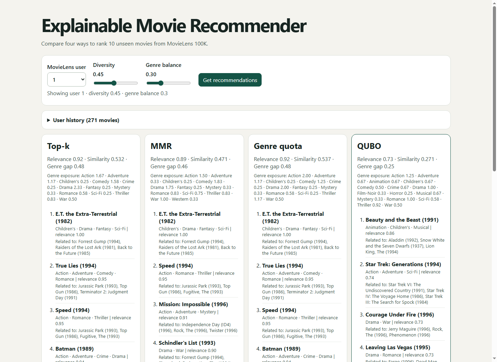

# Explainable Movie Recommendations with QUBO Reranking

This local demo compares four ways to recommend 10 unseen movies to a MovieLens user. It shows which movies from the user's history contributed to each recommendation.

## 1. Clone the project

Install Git and Python 3.10 or later. Open PowerShell on Windows or Terminal on macOS or Linux, then run:

```sh
git clone https://github.com/HuzaifaAbdulRehman/explainable-movie-recommender.git
cd explainable-movie-recommender
```

If you use GitHub's **Code → Download ZIP** option, extract the ZIP and open a terminal in the extracted project folder instead. Run all remaining commands from that folder.

## 2. Set up Python and download MovieLens

**Windows PowerShell**

```powershell
python -m venv .venv
.\.venv\Scripts\python.exe -m pip install -r requirements.txt
curl.exe -fL https://files.grouplens.org/datasets/movielens/ml-100k.zip -o ml-100k.zip
```

If Windows recognizes `py` instead of `python`, run `py -3 -m venv .venv` as the first command.

**macOS or Linux**

```sh
python3 -m venv .venv
.venv/bin/python -m pip install -r requirements.txt
curl -fL https://files.grouplens.org/datasets/movielens/ml-100k.zip -o ml-100k.zip
```

If the download command fails, download **ml-100k.zip** from [GroupLens](https://grouplens.org/datasets/movielens/100k/) in your browser and save it next to `serve.py`. Keep the archive zipped.

## 3. Run the demo

Windows PowerShell:

```powershell
.\.venv\Scripts\python.exe serve.py
```

macOS or Linux:

```sh
.venv/bin/python serve.py
```

Open [http://127.0.0.1:8765](http://127.0.0.1:8765) and keep the terminal open during the demo. Press **Ctrl+C** in the terminal to stop the server.

1. Select a MovieLens user and click **Get recommendations**.
2. Open **User history** and compare the Top-k, MMR, Genre quota and QUBO lists. Each list should show 10 movies.
3. Change the **Diversity** and **Genre balance** sliders and click **Get recommendations** again. With both sliders at zero, QUBO keeps the Top-k list.
4. Open **Offline evaluation** to see the 943-user benchmark. Use **Record your judgment** to save relevance and variety preferences in the local `judgments.csv`.



The running demo compares all four methods on the same MovieLens profile.

## 4. Run the tests and benchmark

Open a second terminal in the project folder if you want to leave the demo running.

**Windows PowerShell**

```powershell
.\.venv\Scripts\python.exe -m unittest -v
.\.venv\Scripts\python.exe evaluate.py
```

**macOS or Linux**

```sh
.venv/bin/python -m unittest -v
.venv/bin/python evaluate.py
```

The two tests should finish with `OK`. They cover the dataset split, movie mapping, unique recommendations outside the user's history, and fixed-seed repeatability. Evaluation runs all 943 users and rewrites `results.json`. Refresh the demo to see the updated numbers. Timing varies by laptop.

The [research report](Report.pdf) is also available as [LaTeX source](Report.tex).

Dataset citation. F. Maxwell Harper and Joseph A. Konstan. 2015. The MovieLens Datasets: History and Context. ACM Transactions on Interactive Intelligent Systems 5(4), Article 19. [DOI](https://doi.org/10.1145/2827872)
